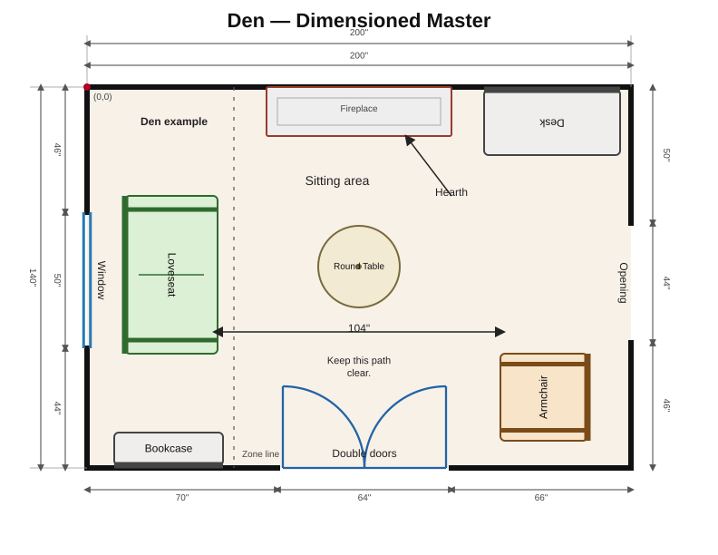

# Room Layout

Generate dimensioned room SVGs from YAML, then overlay furniture, layouts, and
annotations.



## Quick start

Requires Python 3.10 or later.

```powershell
python -m venv .venv
.\.venv\Scripts\Activate.ps1
python -m pip install -r requirements.txt
python .\generate_room.py .\examples\rooms\den\room.yaml
python .\render_layout.py --room .\examples\rooms\den --furniture .\examples\furniture.yaml
```

This writes `room.svg` and `room_with_furniture.svg` in `examples\rooms\den`.
The other example room is `examples\rooms\studio`. All example data is invented.

## Coordinate system

All coordinates are inches. `(0,0)` is the northwest inside corner, `x`
increases east, and `y` increases south. Wall offsets are measured west-to-east
on north/south walls and north-to-south on east/west walls.

See [schema.md](schema.md) for the data model.

## Project structure

- `get_furniture.py` — merges `furniture*.yaml` into `furniture.yaml`
- `generate_room.py` — converts a `room.yaml` into `room.svg`
- `render_layout.py` — overlays furniture and annotations
- `annotations.yaml` — fallback when a room has no annotations of its own
- `examples/` — example furniture catalog and rooms

## Use your own rooms

Put your data beside the scripts. Git ignores these paths, so your floor plans
are not committed by default:

- `furniture.yaml` — shared furniture catalog
- `rooms/<name>/room.yaml` — fixed room geometry
- `rooms/<name>/layout.yaml` — furniture placements
- `rooms/<name>/annotations.yaml` — optional presentation notes

```powershell
python .\generate_room.py .\rooms\myroom\room.yaml
python .\render_layout.py --room myroom
```

`render_layout.py` finds a named room relative to the project directory,
whatever the current directory, and writes
`rooms\myroom\room_with_furniture.svg`.

Use `--furniture`, `--layout`, `--annotations`, and `--output` to choose other
paths. Use `--validate-only` to check the YAML without writing an SVG.

## Merge furniture files

You can split the catalog into files such as `furniture_seating.yaml` and
`furniture_tables.yaml`. Run the merge from the directory that contains them:

```powershell
cd examples
python ..\get_furniture.py
```

Files merge in name order and the last definition wins. This overwrites
`furniture.yaml`, so edit the source files instead.

## Run the tests

```powershell
python -m pip install -r requirements-dev.txt
python -m pytest --cov
```

The tests check that the committed example files match what the scripts produce.
After an intentional drawing change, regenerate both example rooms with the
quick-start commands, review them, and commit the new SVGs.

## License

[MIT](LICENSE)
