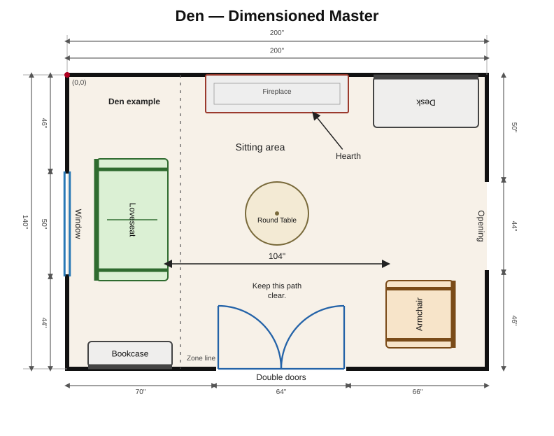

# YAML Room Planner

Generate dimensioned room SVGs from YAML, then overlay furniture, layouts, and
annotations.



## Install

Requires Python 3.10 or later. From a clone of this repository:

```powershell
python -m venv .venv
.\.venv\Scripts\Activate.ps1
python -m pip install -e .
```

This installs the `room-planner` command. If Windows blocks it because the
launcher is not signed, use `python -m room_planner` instead; everything else is
the same.

## Quick start

Your rooms live in their own folder, outside this repository:

```powershell
room-planner init D:\plans\my-house
cd D:\plans\my-house
room-planner build living
```

`build` merges the furniture files, draws `room.svg`, and then draws
`room_with_furniture.svg`. To build the included sample house, whose data is
invented:

```powershell
room-planner build --all --project examples\house
```

## Organize your rooms

A folder that contains `room.yaml` is a room. A project can be a whole house:

```text
my-house/
  furniture_seating.yaml
  furniture_tables.yaml
  furniture.yaml              generated
  annotations.yaml            optional, for rooms without their own
  living/
    room.yaml                 fixed room geometry
    layout.yaml               furniture placements
    annotations.yaml          optional presentation notes
    room.svg                  generated
    room_with_furniture.svg   generated
  bedroom/
    ...
```

Room folders can also be inside a `rooms` folder. Or a project can be one room,
with everything in the same folder (`room-planner init --single`).

Either kind can be its own Git repository. Output is the same on every run, so
you can commit the generated files and review drawing changes as diffs.

Floor plans can be private. Think before you push them to a public repository.

## Commands

| Command | Purpose |
|---|---|
| `room-planner init DIR` | Create a starter project |
| `room-planner build ROOM` | Merge, generate, and render |
| `room-planner merge` | Only merge `furniture_*.yaml` into `furniture.yaml` |
| `room-planner generate ROOM` | Only draw `room.svg` |
| `room-planner render ROOM` | Only draw furniture and annotations |

- The project is the current directory unless you pass `--project DIR`.
- Use `--all` in place of `ROOM` for every room. In a single-room project or a
  room's own folder, leave `ROOM` out.
- `render` accepts `--layout`, `--annotations`, and `--output` for alternative
  layouts, and `--validate-only` to check the YAML without writing an SVG.
- Run `room-planner COMMAND --help` for every option.

## Furniture

Split your catalog into as many `furniture_*.yaml` files as you like. They merge
in name order and the last definition wins. Edit those files rather than
`furniture.yaml`, which is generated. A `furniture.yaml` that room-planner did
not generate is not overwritten unless you run `room-planner merge --force`.

Furniture comes from the first place that has any: the room's folder, then the
project folder. To share furniture between projects, pass
`--furniture PATH` with a furniture file or a folder of them.

## Coordinate system

All coordinates are inches. `(0,0)` is the northwest inside corner, `x`
increases east, and `y` increases south. Wall offsets are measured west-to-east
on north/south walls and north-to-south on east/west walls.

See [schema.md](schema.md) for the data model.

## Run the tests

```powershell
python -m pip install -e .[dev]
python -m pytest --cov
```

The tests check that the committed example files match what the scripts produce.
After an intentional drawing change, rebuild the sample house with the command
above, review it, and commit the new SVGs.

## License

[MIT](LICENSE)
